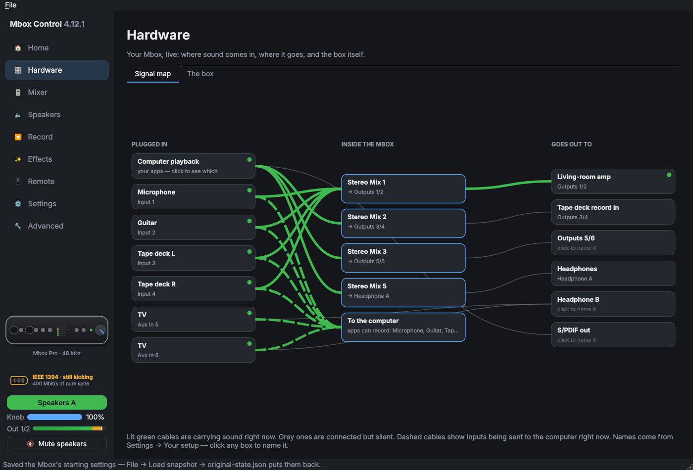
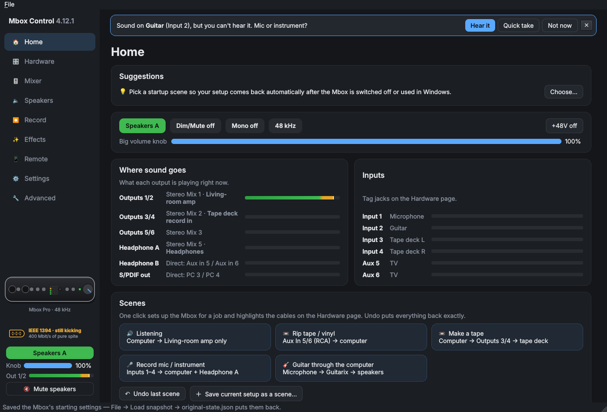
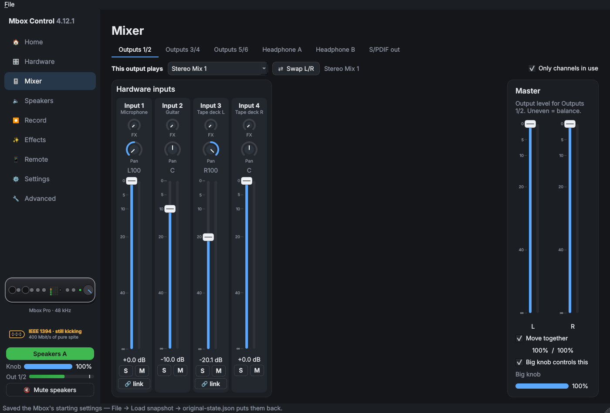
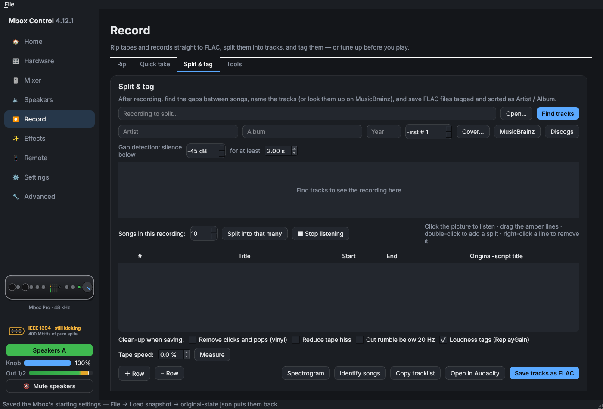
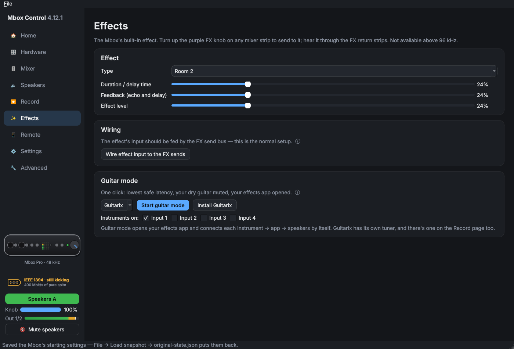
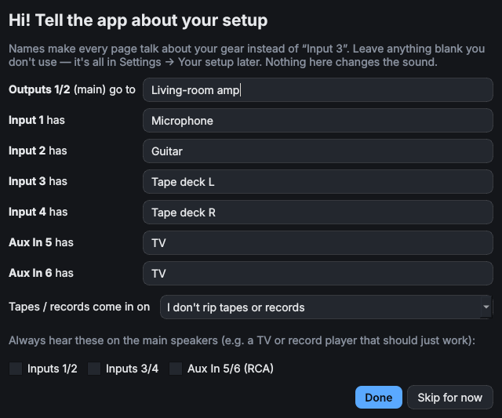
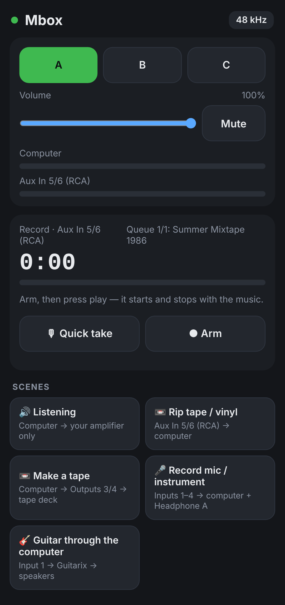

# Mbox Control

**A modern Linux control panel for the Avid Mbox Pro (3rd generation).**
Unofficial: not made, supported or endorsed by Avid. "Mbox" is a trademark of Avid Technology.

The Mbox Pro 3 is a great FireWire interface whose own software stopped at Windows 7 and macOS.
On Linux the audio already works through the kernel's `snd-dice` driver. This app gives you
control of everything else the box can do, and a few things it never could.

> IEEE 1394 · still kicking. 400 Mbit/s of pure spite.



## What it does

- **Live signal map.** It draws what's plugged in, the box's internal mixes and where they go.
  Cables light up while sound is going through them.
- **Router and mixer.** Covers all 6 stereo mixes, the outputs, both headphone outputs and S/PDIF. Pan, mute, solo and link work on any channel.
- **Speaker sets.** Gives the front **Spkr** button real A/B/C speaker switching. Mute and dim work too.
- **Scenes.** One click sets the box up for listening, ripping, recording or playing guitar
  through the computer. Undo puts everything back. You can also save your own scenes.
- **Ripping tapes and records.** Hands-free mode starts recording when the music starts and stops
  at the end of the side. You can split by silence or by song count on a waveform, and look up
  titles on MusicBrainz or Discogs. Tracks save as tagged FLAC with cover art and ReplayGain. It
  can also correct a deck that runs fast or slow.
- **Guitar mode.** Opens Guitarix at low latency and wires it up for you. Each instrument input
  you choose gets its own Guitarix, so a guitar and a bass can play at once.
- **Quick takes.** Record a mic or instrument with one button, saved as FLAC.
- **Plug-in hints.** When sound turns up on an input that isn't going anywhere, it offers to let you
  hear it, rip it or record it.
- **Apps and speakers.** Send any app to the speakers, the headphones only, or AirPlay speakers
  around the house.
- **Phone remote.** Scan a QR code to control speakers, volume, scenes and recording from your phone.
- **Tray, shortcuts, MIDI.** There's a quick panel in the system tray, Ctrl+K to jump to anything,
  KDE global shortcuts, and MIDI controller mapping.
- **Recovery.** It reconnects after the box is power-cycled or the computer sleeps, revives frozen
  meters, and restores your setup when the box forgets it.

## Screenshots

| | |
|---|---|
|  |  |
|  |  |
|  |  |

## Supported systems

| | Tested | Notes |
|---|---|---|
| **Arch** and friends (CachyOS, Manjaro, EndeavourOS) | daily use | |
| **Ubuntu 24.04+** and friends (Mint 22, Pop!_OS, Kubuntu) | installer, end to end | PySide6 comes from pip |
| **Debian 12+** | installer written for it | Debian 13 packages more of the pieces |
| **Fedora 39+** | installer written for it | Uses `ffmpeg-free` unless you already have RPM Fusion's ffmpeg |

You need **PipeWire** for sound. It's the default on all of the above.

You also need a FireWire port. A PCIe card with a **Texas Instruments** chipset is the safe choice.

## Install

Download the latest release from the **Releases** page and unpack it, or `git clone` this repository.
Then run this inside the folder:

```
bash install.sh
```

Run it as yourself, not root. It asks for your password when it needs it. Running it again updates
the app. It:

1. Installs the packages for your system: Python and PySide6, NumPy, FFmpeg, alsa-utils, pactl
   and PipeWire tools. If your distro doesn't package PySide6, it installs it with pip, just for the app.
2. Builds **snd-dice-ctl-service** from
   [snd-firewire-ctl-services](https://github.com/alsa-project/snd-firewire-ctl-services) if you
   don't have it already. This takes 5–10 minutes, once. Along the way it builds any of
   libhinawa, libhitaki and alsa-gobject your distro doesn't package. If your Rust is older than
   1.78, it installs the current one with rustup in your home folder.
3. Lets you use the Mbox without root. Most current distros already allow this; on older ones the
   installer adds a udev rule.
4. Copies the app to `~/mbox-control` and adds it to your app launcher.

Optional extras get installed from inside the app when you first use them, with one password
prompt: Audacity, Guitarix, Chromaprint for song identification, and Avahi for AirPlay.

### Arch (AUR)

Once it's published: `paru -S mbox-control`, or the same with `yay`. The AUR package gets the control service from
`snd-firewire-ctl-services-git`.

## Reporting problems

Open an issue and paste the output of **Settings → App → Copy diagnostics**. Nothing personal is
included.

## First run

A short setup asks what's plugged in where, for example what Outputs 1/2 feed and what's on each
input. Everything is optional, and you can change it any time in **Settings → Your setup**.

## Known limits

- Only tested on the Mbox Pro 3. Other DICE-based interfaces won't work without changes.
- Above 96 kHz the box only has two stereo mixes and no reverb. This is a hardware limit.
- AirPlay plays about 1.5 seconds behind, so use it for other rooms.
- The phone remote works over plain HTTP on your home network, paired by the code in its QR link.
  It can go on your home screen but opens in a browser tab.

## Development

The tests run against a simulated Mbox, built from a real Mbox Pro 3's control list. You don't
need the hardware, PipeWire or a screen:

```
pip install PySide6 numpy pytest
pytest -q
```

GitHub runs the same tests, plus a lint check, on every push.

## License

GPL-3.0-or-later; see [LICENSE](LICENSE). You can use, share and change it, and anything
built from it has to stay open source under the same terms.

## Credits

The [snd-dice](https://github.com/torvalds/linux/tree/master/sound/firewire/dice) kernel driver
and Takashi Sakamoto's snd-firewire-ctl-services do the hard part. This app is the friendly face
on top of them.
